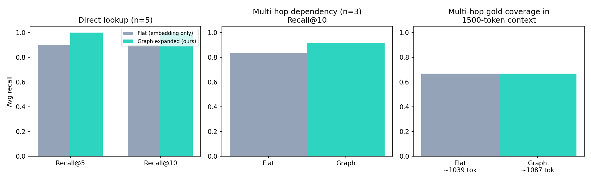

# repo-graph-rag

**Graph-grounded retrieval augmentation for offline Gemma 4 coding agents.**
An open-source library that turns repository code-graphs and code embeddings into
structured, budget-aware context for software-engineering (SWE) agents that run
fully offline on consumer hardware.

Built for the [Gemma 4 Developer Agent — Paper Track](https://www.kaggle.com/competitions/gemma-4-developer-agent-paper) (Kaggle / Google DeepMind).

## Why

Cloud API coding agents dominate SWE-bench, but the goal of an *offline* agent
(fits on a single consumer accelerator) fails at a mundane step: **finding the
right code**. Flat chunk-and-embed retrieval loses exactly the structure that
matters — callers, callees, imports — so the model hallucinates dependencies it
never saw.

repo-graph-rag fixes this by combining a **repository code graph** with a
**pluggable code-embedding index** through **graph-propagation reranking**,
then assembling context under a strict token budget.

## Features

- `build_graph()` — static (AST) repository code graph: module/class/function/method
  nodes; `DEFINES` / `IMPORTS` / `CALLS` edges; hub-name noise capping; JSON-serializable.
- `TfidfEmbedder` — zero-dependency reference embedder. The interface
  (`embed()` / `embed_node()`) is deliberately identical to a dense code-embedding
  adapter, so official **Gemma 4 embeddings** drop in with two methods.
- `GraphRetriever` — semantic seeds + propagation over `CALLS`/`IMPORTS`,
  merged reranking (no seed lock-in), and budgeted context assembly.

## Install

```bash
pip install -e .
# or directly:
pip install "git+https://github.com/Hkate777/repo-graph-rag.git"
```

## Quickstart

```python
from repo_graph_rag import build_graph, TfidfEmbedder, GraphRetriever

g = build_graph("path/to/repo", "package_dir")
ids = [i for i, n in g.nodes.items() if n.type in ("function", "method")]
emb = TfidfEmbedder()
emb.fit(ids, [g.nodes[i].doc + "\n" + g.nodes[i].code for i in ids])

r = GraphRetriever(g, emb)
nodes = r.graph_retrieve("decode token and verify its signature", k_seeds=5)
context, tokens = r.assemble_context(nodes, budget_tokens=1500)
```

## Reproduce the benchmark

```bash
python experiments/run_demo.py
```

Outputs `results/results.json` and `results/fig_retrieval_comparison.png`
(clones [pyjwt](https://github.com/jpadilla/pyjwt) automatically on first run).

## Prototype results (pyjwt, 173 nodes / 419 edges)

| Suite | Metric | Flat (embedding only) | Graph-expanded (ours) |
|---|---|---|---|
| Direct lookup (n=5) | recall@5 / recall@10 | 0.90 / 0.90 | **1.00 / 1.00** |
| Multi-hop dependency (n=3) | recall@10 | 0.833 | **0.917** |
| Multi-hop | gold coverage in 1500-token context | 0.667 | 0.667 (≈ same tokens) |



Gains concentrate exactly where lexical retrieval underdetermines structure:
multi-file flows and dependency/impact queries.

## Roadmap

- Adapter for the competition-provided **code-graphs** and **Gemma 4 embeddings**
  (two-method interface, no pipeline changes).
- Scale evaluation to a 50–100 task SWE-bench Lite subset: retrieval recall,
  context tokens, and end-to-end patch accuracy with an offline Gemma 4 agent
  (E4B / 26B MoE).
- Ablations: graph-only vs embed-only vs hybrid; propagation weight `beta` sweep.

## Repository layout

```
src/repo_graph_rag/   # library (codegraph.py, retriever.py)
experiments/          # reproducible demo
results/              # results.json + figures
paper/                # competition writeup (PROJECT_DESCRIPTION.md)
notebooks/            # demo notebook
docs/                 # literature notes, paper outline
```

## Citation

```
Hkate777. repo-graph-rag: Graph-Grounded Retrieval for Offline Gemma 4
Coding Agents. Kaggle Gemma 4 Developer Agent Paper Track, 2026.
```

## License

Apache 2.0 — see [LICENSE](LICENSE).
